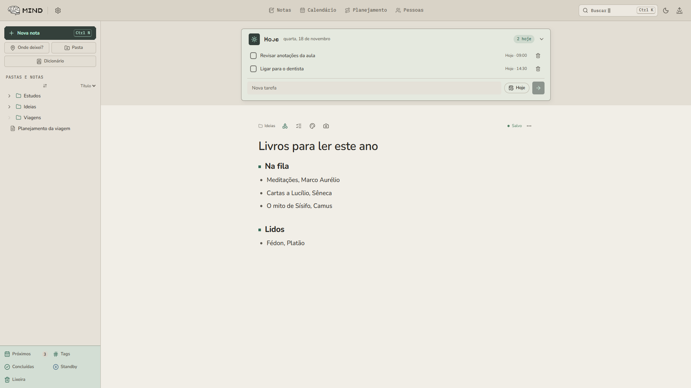
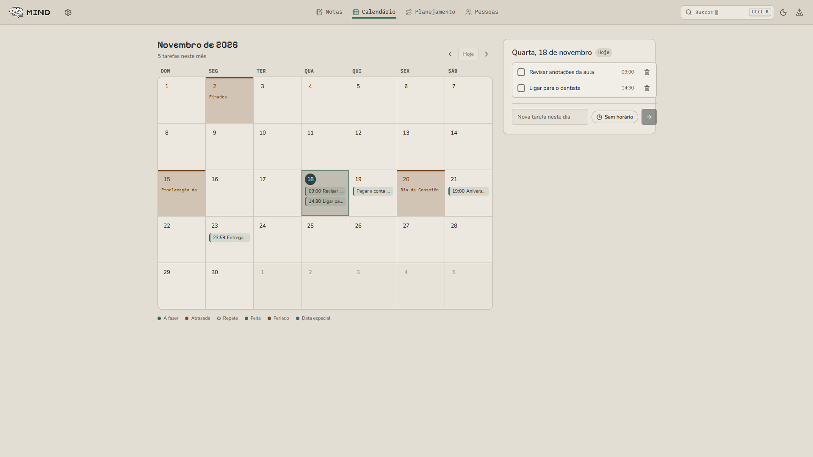
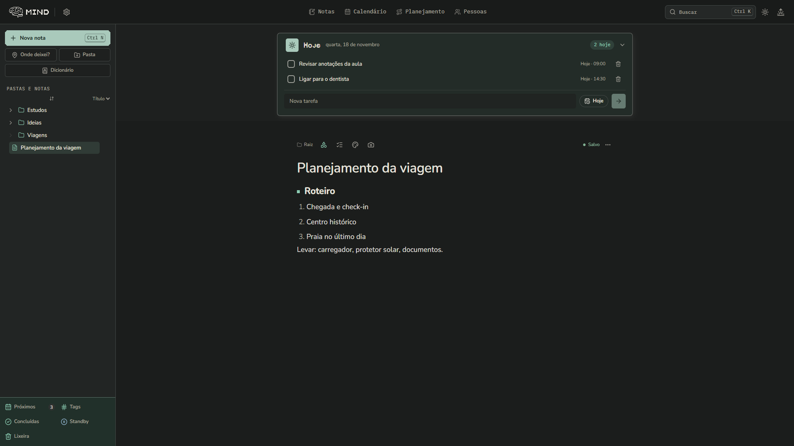

<h1 align="center">Mind</h1>

<b>A escrita é o remédio da memória.</b> 
Notas, tarefas, calendário e lembretes num lugar só, no PC e no celular.

  
  &nbsp;
  

  
  
  

  <a href="https://oforas.github.io/mind/">Site do Mind</a> ·
  <a href="https://apps.microsoft.com/detail/9NMQVWF6TWW7?hl=pt-BR&gl=BR">Microsoft Store</a> ·
  <a href="https://oforas.github.io/mind/privacidade/">Privacidade</a>

  

## Para quem é

O Mind nasceu para quem esquece as coisas: o pensamento que some antes de ser anotado, a tarefa que passa do dia, a chave que ninguém sabe onde ficou. Tudo é pensado para anotar rápido e ser lembrado na hora certa, sem distração e com cores calmas para os olhos.

## O que ele faz

**Notas**
- Pastas, títulos em níveis (é só apertar <kbd>Tab</kbd>), negrito com <kbd>Ctrl</kbd>+<kbd>B</kbd>, listas, checklist e fotos.
- Cor nas letras e nos títulos, e ícones para cada nota e pasta (inclusive os seus).
- "Definir checklist" em qualquer frase: marcou, ela ganha um risco.
- Corretor de português que funciona sem internet e mostra a palavra certa no botão direito.

**Tarefas e lembretes**
- O painel **Hoje** fica no topo, com as tarefas atrasadas e as do dia.
- Lembretes que insistem até você marcar "Feito", com a opção de adiar.
- Tarefas sem data ficam à parte e vão ficando mais vermelhas conforme os dias passam.
- No celular, aviso das tarefas do dia, 5 minutos antes e na hora.

**Calendário e planejamento**
- Calendário do mês com feriados do Brasil e datas especiais.
- Quadro de planejamento para ligar ideias e etapas.

**Para a memória do dia a dia**
- **Pessoas:** um mural de polaroids com foto e o que você quer lembrar de cada um, separado em grupos.
- **Onde deixei?:** anote onde guardou algo (com foto) e ache depois pela busca.
- **Dicionário:** significado, sinônimos e um exemplo de uso, sem sair da nota.
- **Busca** em tudo com <kbd>Ctrl</kbd>+<kbd>K</kbd>.

**Seguro e sempre com você**
- Funciona sem internet. Com uma conta, sincroniza o PC e o celular.
- Tema claro e escuro, PIN para abrir o app e backup automático.

  
  &nbsp;
  

## Como instalar no Windows

1. Clique no botão verde **Baixar para Windows**. Ele abre a versão mais recente.
2. Em **Assets**, clique no arquivo **Mind-Setup-….exe**. Ele vai para a pasta **Downloads**.
3. Abra o arquivo. Se aparecer a tela azul **"O Windows protegeu o computador"**, clique em **Mais informações** e depois em **Executar assim mesmo**.
4. Siga a instalação e abra o Mind.

> **Por que esse aviso aparece?** O Windows mostra essa tela para programas sem certificado digital pago, como é o caso do Mind. Baixe sempre por este botão ou pelo site, para ter certeza de que o arquivo é o original. Se preferir evitar o aviso, instale pela [Microsoft Store](https://apps.microsoft.com/detail/9NMQVWF6TWW7?hl=pt-BR&gl=BR).

## Como usar no celular

1. Abra **[oforas.github.io/mind/app](https://oforas.github.io/mind/app/)** no navegador do celular (Chrome no Android, Safari no iPhone).
2. Use **Adicionar à tela inicial** (ou **Instalar app**) no menu do navegador.
3. O Mind aparece como um app na tela do celular. Entre com a mesma conta do PC para ver as mesmas notas e tarefas.

## Atualizações

Depois de instalado, as novas versões chegam pelo próprio app. Você não precisa voltar aqui para baixar de novo. As novidades de cada versão ficam em [Releases](https://github.com/oForas/mind/releases).

---

Desenvolvido por <a href="https://instagram.com/z.foras">z.foras</a>

